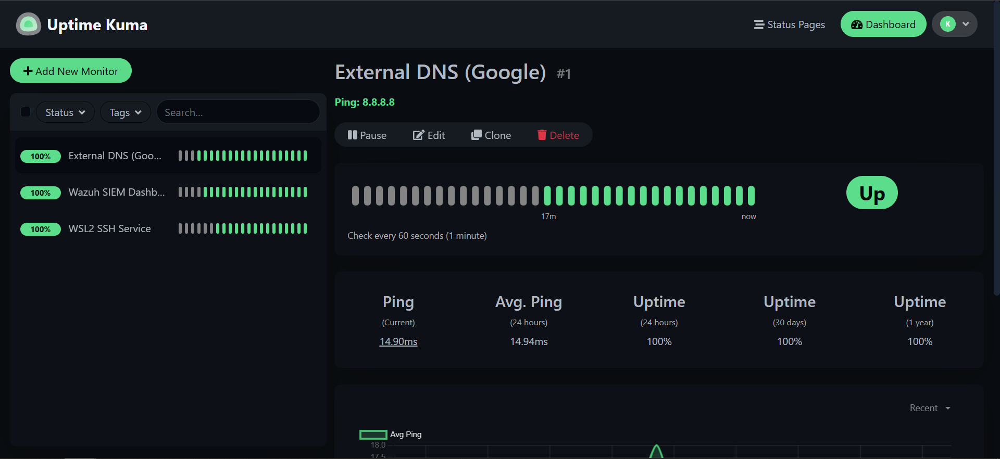

# IT Helpdesk lab

A home lab running on Windows 10, WSL2 (Ubuntu), and Docker. I use it to practice IT helpdesk tasks: service monitoring, endpoint log analysis, and network troubleshooting.

## Architecture

```text
┌──────────────────────────────────────────────────────────┐
│                  WINDOWS 10 WORKSTATION                  │
│                                                          │
│  ┌────────────────────────────────────────────────────┐  │
│  │                 WSL2 (Ubuntu Linux)                │  │
│  │               Docker Bridge: 172.17.0.1            │  │
│  │                                                    │  │
│  │   ┌──────────────────┐      ┌──────────────────┐   │  │
│  │   │   Uptime Kuma    │      │    Wazuh SIEM    │   │  │
│  │   │  Port: 3001/TCP  │─────▶│  Port: 443/TCP   │   │  │
│  │   │ (Proactive Mon.) │      │ (Endpoint Sec.)  │   │  │
│  │   └────────┬─────────┘      └──────────────────┘   │  │
│  │            │                                       │  │
│  │            ├──▶ TCP 22 (Local SSH Service)         │  │
│  │            └──▶ ICMP Ping (8.8.8.8 External DNS)   │  │
│  └────────────────────────────────────────────────────┘  │
└──────────────────────────────────────────────────────────┘
```

## Services

| Service | Runtime | Endpoint / Port | Purpose |
| :--- | :--- | :--- | :--- |
| Uptime Kuma v2 | Docker (SQLite) | `localhost:3001` | Service and network availability checks |
| Wazuh SIEM | Docker Compose | `https://172.17.0.1:443` | Endpoint log collection and brute-force alerts |
| OpenSSH Server | WSL2 (Ubuntu) | `172.17.0.1:22` | Remote access and authentication log testing |

## Monitoring

Uptime Kuma checks three targets every 60 seconds:
- ICMP ping to `8.8.8.8` for external connectivity
- HTTPS check on the Wazuh dashboard (ignoring the self-signed TLS certificate)
- TCP port 22 check on `172.17.0.1` for the local SSH daemon



## Security and log analysis

I ran simulated SSH brute-force attempts against the local host to verify that Wazuh generates alerts. I also inspected raw `/var/log/auth.log` entries to separate actual attacks from false positives like routine `sudo` usage.

## Network diagnostics

- Local interface and ARP inspection with `iproute2` (`ip a`, `ip neigh`)
- Listening TCP/UDP sockets and process IDs with `ss`
- Port and service version scanning with `nmap`
- Live packet capture with `tcpdump`, filtering `PSH` packets and reading `.pcap` files

## Troubleshooting

When something breaks in the lab (outdated Docker image tags, database setup errors, or container networking issues), I follow four steps:
1. Check container status (`docker ps`), open ports, and network reachability.
2. Read the logs (`docker logs`, `/var/log/auth.log`) or capture traffic with `tcpdump`.
3. Fix the root cause.
4. Verify the service is back up and write down what happened.

## Runbooks

- `docs/onboarding-macos-mdm.md`: zero-touch MacBook setup with ABM, MDM, and FileVault
- `docs/offboarding-google-workspace.md`: suspending accounts, revoking sessions, and transferring Drive ownership
- `docs/phishing-incident-response.md`: L1 containment and escalation to SOC

## Scope

Everything here runs locally for practice and interview prep. It reflects home-lab work, not production experience.
